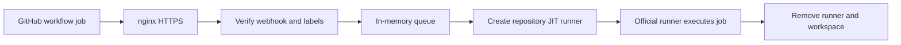

# runnerd

A lightweight GitHub Actions runner broker for personal repositories. runnerd provisions temporary repository-scoped runners on your own Linux machine, allowing multiple repositories to use the same host without creating a GitHub organization.

## Overview

GitHub registers self-hosted runners at repository, organization, or enterprise scope. runnerd uses a GitHub App to receive workflow job events and create a just-in-time (JIT) runner for whichever installed repository needs one.

The official GitHub Actions runner executes the job, including ordinary `run:` and supported `uses:` steps. runnerd manages authentication, queueing, runner processes, and cleanup. GitHub continues to handle workflow triggers, dependencies, concurrency groups, secrets, cancellation, and job logs.

The project supports Linux ARM64 and amd64. The deployment instructions use PM2 to supervise the broker and nginx to provide public HTTPS access.



## Features

- Share one machine across multiple personal GitHub repositories
- Repository and installation information taken directly from signed webhooks
- GitHub App authentication with cached installation tokens
- Configurable runner label, queue capacity, and global concurrency
- One disposable runner workspace, home, and temporary directory per job
- Single-job JIT runners using the existing official runner installation
- Delivery and job deduplication with a bounded one-hour cache
- Graceful shutdown and cleanup of owned runner processes
- Readable console logs and local health endpoints
- One Go binary with no third-party Go dependencies or external database

## Tech stack

| Area | Technology |
| --- | --- |
| Broker | Go 1.26+, standard library |
| Authentication | GitHub App JWTs and installation access tokens |
| Job execution | Official GitHub Actions self-hosted runner |
| Queue | Buffered Go channel and worker pool |
| Logging | `log/slog` with a plain-text console handler |
| Process supervision | PM2 |
| HTTPS | nginx and an existing TLS certificate |

## Project structure

```text
runnerd/
├── cmd/runnerd/          # Application entry point and HTTP server
├── internal/
│   ├── config/          # Environment configuration and validation
│   ├── dedupe/          # Bounded delivery and job cache
│   ├── github/          # App authentication and repository runner APIs
│   ├── logging/         # Plain-text log formatting
│   ├── model/           # Runner request metadata
│   ├── queue/           # Job queue and worker lifecycle
│   ├── runner/          # Isolated workspaces and process supervision
│   └── webhook/         # Signature verification and event handling
├── .env.example
├── .gitignore
├── go.mod
└── README.md
```

## Prerequisites

- A Linux ARM64 or amd64 host
- [Go](https://go.dev/doc/install) 1.26 or newer to build the broker
- An official GitHub Actions runner distribution for the host architecture
- A private GitHub App installed on the repositories that should use the broker
- PM2 and nginx for the deployment described below
- git and any tools required by your workflows, such as Node.js and npm

Run runnerd as a regular Linux user with access to the tools and files required by your workflows. If jobs manage existing PM2 applications, use the account that owns those applications and set that daemon's absolute `PM2_HOME` globally in runnerd's environment file, as described below. The setup commands use your current user's home directory and identity.

## Setup

### 1. Configure the GitHub App

Create or update your private GitHub App with these repository permissions:

| Permission | Access |
| --- | --- |
| Actions | Read-only |
| Administration | Read and write |

Enable webhooks, subscribe to **Workflow job**, and set the webhook URL to your server's public HTTPS address. Use your own domain or subdomain; `runner.example.com` below is a placeholder:

```text
https://runner.example.com/
```

Keep TLS verification enabled. Generate a webhook secret with:

```bash
openssl rand -hex 32
```

Use the same secret in the App settings and `GITHUB_WEBHOOK_SECRET`. Record the App ID, generate its private key, and install the App on your personal account's trusted selected repositories. Installation IDs are read from webhooks; repository names do not belong in the broker configuration.

### 2. Prepare the local directories

Run these one-time setup commands from the account that will run runnerd. They use sudo to create the system directories, with ownership assigned to your current user and primary group:

```bash
RUNNERD_USER="$(id -un)"
RUNNERD_GROUP="$(id -gn)"

sudo install -d -o "$RUNNERD_USER" -g "$RUNNERD_GROUP" -m 0755 /opt/runnerd
sudo install -d -o "$RUNNERD_USER" -g "$RUNNERD_GROUP" -m 0700 \
  /var/lib/runnerd /var/lib/runnerd/runners /etc/ssl/runnerd

sudo install -o "$RUNNERD_USER" -g "$RUNNERD_GROUP" -m 0600 \
  /path/to/downloaded-app-private-key.pem /etc/ssl/runnerd/github-app.pem
```

Replace the source key path with your downloaded PEM file. The private key must be readable by the account running runnerd and inaccessible to group and other users. The key location is configurable through `GITHUB_PRIVATE_KEY_PATH`.

Normal broker and runner execution does not require root.

### 3. Install the runner template

Store the official Linux runner distribution for your host's architecture at:

```text
/opt/runnerd/runner
```

Get the download and checksum instructions from repository **Settings → Actions → Runners → New self-hosted runner**, selecting Linux and your host's architecture, or use the [official runner releases](https://github.com/actions/runner/releases). Verify the archive checksum, extract it into the template directory, and install any required OS dependencies.

**Do not run `config.sh` or `run.sh` in this directory.** It must remain a pristine template. runnerd copies it into a private temporary directory for each job and starts that copy with its JIT configuration.

The template should contain `run.sh`, `config.sh`, `bin/`, `externals/`, and the runner helper scripts. A previously configured installation containing `.runner`, `.credentials`, `.env`, `.path`, `_work`, or `_diag` is rejected. If you already have a clean template, no new download is needed.

### 4. Configure the environment

From the repository root, create a protected environment file outside the checkout:

```bash
umask 077
mkdir -p "$HOME/.config/runnerd"
chmod 700 "$HOME/.config/runnerd"
cp .env.example "$HOME/.config/runnerd/env"
chmod 600 "$HOME/.config/runnerd/env"
nano "$HOME/.config/runnerd/env"
```

Fill in `GITHUB_APP_ID`, `GITHUB_PRIVATE_KEY_PATH`, and `GITHUB_WEBHOOK_SECRET`. The example uses port `3333` and a one-hour runner timeout.

For workflows that manage existing PM2 apps, also set `PM2_HOME` once in this environment file. Use the existing daemon's absolute state directory; replace `/home/deploy/.pm2` below with your account's actual PM2 directory:

```bash
PM2_HOME='/home/deploy/.pm2'
```

runnerd passes this value to every job, so deployment workflows do not need to set it individually. Job `HOME` remains disposable. PM2 reads `PM2_HOME` automatically; no runnerd code changes are required.

runnerd reads environment variables; it does not automatically load `.env` files. Load this shell-format file before starting the application:

```bash
set -a
. "$HOME/.config/runnerd/env"
set +a
```

`set -a` exports variables assigned while sourcing the file. `set +a` restores normal shell behavior. Keep values quoted when they contain spaces or shell characters.

### 5. Build and start runnerd

Build directly on the Linux host from the repository root:

```bash
go build -trimpath -o runnerd ./cmd/runnerd
```

For a foreground check, run `./runnerd` in the shell where you loaded the environment. Stop it with Ctrl+C before starting PM2.

To supervise the binary with PM2:

```bash
pm2 start "$PWD/runnerd" --name runnerd --interpreter none --kill-timeout 45000
pm2 save
pm2 logs runnerd --lines 20
```

Run these commands as the account that will execute workflow jobs. PM2 retains the supplied environment across normal restarts. No ecosystem file is required.

## Environment variables

| Variable | Default | Description |
| --- | --- | --- |
| `GITHUB_APP_ID` | Required | Positive GitHub App ID |
| `GITHUB_PRIVATE_KEY_PATH` | Required | Absolute path to the protected RSA private key |
| `GITHUB_WEBHOOK_SECRET` | Required | Shared secret matching the App webhook settings |
| `LISTEN_ADDR` | `127.0.0.1:8080` | Local HTTP bind address; `.env.example` uses `127.0.0.1:3333` |
| `RUNNER_HOME` | `/opt/runnerd/runner` | Pristine official runner template |
| `RUNNER_STATE_DIR` | `/var/lib/runnerd/runners` | Dedicated writable directory for temporary runners |
| `RUNNER_LABEL` | `runnerd` | Custom label that jobs must request |
| `RUNNER_GROUP_ID` | `1` | Repository JIT runner group ID |
| `MAX_CONCURRENT_RUNNERS` | `1` | Maximum active runners across all repositories |
| `QUEUE_SIZE` | `100` | Maximum pending requests in the channel |
| `LOG_LEVEL` | `info` | `debug`, `info`, `warn`, or `error` |
| `SHUTDOWN_TIMEOUT` | `30s` | Shutdown budget used for HTTP and runner termination |
| `RUNNER_TIMEOUT` | `24h` | Runner lifecycle limit after dequeue; `.env.example` uses `1h` |
| `PM2_HOME` | Not set by runnerd | Existing PM2 daemon's absolute state directory; set globally in runnerd's environment file for all deployment jobs to inherit |

Paths must be absolute, and the template and state directories must not overlap. Configuration, key access, template validation, state access, and bind errors stop the application at startup.

`RUNNER_TIMEOUT` includes preparation, registration, waiting for a job, and job execution. Time waiting in the broker queue is excluded. Reaching the limit terminates the owned runner process group and attempts cleanup.

### Runner group ID

`RUNNER_GROUP_ID=1` is the default because GitHub's [repository JIT API example](https://docs.github.com/en/rest/actions/self-hosted-runners#create-configuration-for-a-just-in-time-runner-for-a-repository) uses `1`. GitHub does not explicitly document this as the personal-account default, so the value remains configurable. runnerd does not call organization runner-group discovery APIs.

The JIT request supplies `name`, `runner_group_id`, `labels`, and `work_folder`. It uses a GitHub App installation token with Administration write permission. API requests include `Accept: application/vnd.github+json` and `X-GitHub-Api-Version: 2026-03-10`, the [documented API version](https://docs.github.com/en/rest/about-the-rest-api/api-versions) checked on October 6, 2026. Rejected JIT requests produce a sanitized error containing the configured group ID, HTTP status, and GitHub message.

## Workflow integration

Change the job's runner selection to:

```yaml
runs-on: [self-hosted, runnerd]
```

The GitHub App must be installed on the repository containing the workflow. Jobs using the configured label execute locally as the user running runnerd. A minimal example:

```yaml
name: Example workflow

on:
  push:
    branches: [main]
  workflow_dispatch:

concurrency:
  group: ${{ github.workflow }}-${{ github.ref }}
  cancel-in-progress: true

jobs:
  example:
    runs-on: [self-hosted, runnerd]
    steps:
      - name: Checkout repository
        uses: actions/checkout@v4

      - name: Run on the self-hosted machine
        run: |
          echo "Running on a runner provisioned by runnerd"
          uname -sm
```

Replace the example commands with your repository's build, test, or deployment steps. Checked-out files live in the temporary Actions workspace. If a job needs a persistent directory elsewhere on the host, reference that path explicitly in the workflow; runnerd has no repository-to-directory mapping.

Job outputs, `needs:` dependencies, and workflow concurrency groups work normally and remain GitHub's responsibility. Each provisioned runner executes at most one job. With one worker, jobs run sequentially.

runnerd only provisions for `workflow_job` events where both the top-level action and nested job status are `queued`, and the requested labels include `RUNNER_LABEL`. The runner is registered with `self-hosted`, `Linux`, the host architecture (`ARM64` or `X64`), and the custom label. Arbitrary additional labels are not copied from the webhook.

Choose actions compatible with the host's architecture and installed tools. runnerd does not install Docker or other workflow dependencies. JavaScript and composite actions can run without Docker; container actions and job/service containers require Docker on the host.

A JIT runner is scoped to a repository, not reserved for the specific job ID that triggered provisioning. GitHub may assign another queued job with matching labels in that repository.

## API overview

| Method | Endpoint | Description |
| --- | --- | --- |
| `POST` | `/` | Canonical signed GitHub webhook endpoint |
| `GET` | `/healthz` | Check whether the HTTP server responds |
| `GET` | `/readyz` | Check local template, key access, and state readiness |

Healthy endpoints return `{"status":"ok"}`. Readiness does not check GitHub permissions or network access.

Accepted requests return `202`; duplicates and ignored events return `200`. Invalid payloads return `400`, invalid signatures `401`, wrong methods `405`, oversized bodies `413`, and capacity/shutdown rejections `503`. Webhook bodies are limited to 2 MiB. Receiving `202` means queued locally, not that the job has completed.

## Production deployment

### nginx

Create a DNS record for your chosen runner hostname pointing at your server. Add this server block alongside your other nginx HTTPS virtual hosts. Replace `runner.example.com` with your domain and the certificate paths with your existing TLS certificate and private key for that hostname:

```nginx
server {
    listen 443 ssl;
    server_name runner.example.com;

    ssl_certificate /path/to/fullchain.pem;
    ssl_certificate_key /path/to/privkey.pem;
    ssl_protocols TLSv1.2 TLSv1.3;
    ssl_ciphers HIGH:!aNULL:!MD5;

    client_max_body_size 2m;
    client_body_timeout 10s;
    client_header_timeout 10s;

    proxy_http_version 1.1;
    proxy_set_header Host $host;
    proxy_set_header X-Forwarded-Host $host;
    proxy_set_header X-Real-IP $remote_addr;
    proxy_set_header X-Forwarded-For $proxy_add_x_forwarded_for;
    proxy_set_header X-Forwarded-Proto $scheme;
    proxy_connect_timeout 3s;
    proxy_send_timeout 10s;
    proxy_read_timeout 10s;
    proxy_cache off;

    location = / {
        limit_except POST { deny all; }
        proxy_pass http://127.0.0.1:3333;
    }

    location ~ ^/(healthz|readyz)$ {
        limit_except GET { deny all; }
        proxy_pass http://127.0.0.1:3333;
    }

    location / {
        return 404;
    }
}
```

Validate with `sudo nginx -t`, then reload nginx using your existing setup. Keep `LISTEN_ADDR` on localhost and match its port to the upstream. nginx provides TLS; the Go server uses plain local HTTP. Disallowed proxy methods return nginx's `403`; direct broker requests return `405`.

Verify the deployment, replacing the example hostname with your own:

```bash
curl --fail http://127.0.0.1:3333/readyz
curl --fail https://runner.example.com/readyz
```

### PM2 and updates

Normal restarts use `pm2 restart runnerd`. After changing environment variables, source the protected file again, then run:

```bash
pm2 restart runnerd --update-env
pm2 save
```

To replace a running binary, build to a temporary filename first. From the repository root:

```bash
go build -trimpath -o runnerd.new ./cmd/runnerd
pm2 stop runnerd
mv runnerd.new runnerd
pm2 restart runnerd
```

This assumes PM2 already points at this repository's `runnerd` binary. Check `pm2 describe runnerd` if you move or rename it. Schedule broker updates between deployments: stopping the broker cancels its active runners and discards queued requests.

The 45-second PM2 kill timeout gives the default 30-second broker shutdown budget room for cleanup. Increase it if you increase `SHUTDOWN_TIMEOUT`. Manage the broker by its own PM2 name; do not use broad commands affecting all applications. Protect PM2's metadata and saved environment under `~/.pm2`, configure log rotation, and use your existing PM2 boot persistence.

### Runner template updates

Keep the official runner template current using the [runner release feed](https://github.com/actions/runner/releases). Stop runnerd between jobs, verify its children have exited, and replace the template with a fresh checksum-verified distribution for the host's architecture. Preserve ownership and executable permissions, leave it unconfigured, then restart runnerd and check readiness. Never carry credentials or workspaces into the new template.

## Logging

Logs use plain text with timestamps, levels, repository names, and job IDs:

```text
2026-10-06 20:45:08 INFO owner/repository job 12345 | job queued
2026-10-06 20:45:10 INFO owner/repository job 12345 | starting runner
2026-10-06 20:45:53 INFO owner/repository job 12345 | runner exited | exit code: 0 | duration: 42.5s
2026-10-06 20:45:54 INFO owner/repository job 12345 | cleanup completed
```

Runner output appears after `runner:`; empty lines are skipped. `LOG_LEVEL=debug` includes delivery/installation/run IDs, runner names, provisioning messages, and ignored event details. GitHub remains authoritative for job results: a runner process exit code alone does not establish workflow success.

## Job storage

Each job gets a fresh instance under `RUNNER_STATE_DIR`. All steps in that job share its workspace, home, and temporary directories. runnerd removes the entire instance after the official runner exits, including after action post-job steps. Existing failure and startup cleanup paths also remove these directories when the instance is eligible for cleanup.

```text
instance-<random>/
  run.sh, bin/, ...    # Official runner installation
  _work/              # Job workspace, created by the official runner
  home/               # HOME
    .config/          # XDG_CONFIG_HOME
    .cache/           # XDG_CACHE_HOME
    .local/share/     # XDG_DATA_HOME
    .local/state/     # XDG_STATE_HOME
  tmp/                # TMPDIR, TMP, TEMP
    xdg-runtime/      # XDG_RUNTIME_DIR
```

These job directories are created with mode `700`. Inherited values of the listed environment variables are replaced for the child runner; the broker's own environment stays unchanged. The pristine runner template must not contain the reserved top-level `home` or `tmp` paths. Actions such as `peaceiris/actions-gh-pages` that create publishing repositories under `$HOME` now leave them inside the disposable instance.

Files and caches inside the instance do not survive between jobs. For persistent deployment output or shared caches, explicitly select an absolute directory outside `RUNNER_STATE_DIR`, such as `/srv/portfolio` or `/var/cache/portfolio-builds`, with permissions for the runner account. Cleanup only removes owned instances; it does not remove external files or old leftovers in the account's real home.

Home-based configuration is also fresh for each job. runnerd does not copy or link the account's existing Git, SSH, or other configuration into the instance. Provision the configuration needed by a job, or explicitly select a persistent configuration file through the tool's options. Tools already installed on the inherited `PATH` remain available, but tools that discover installations or configuration through `$HOME` may need explicit paths.

For deployments that manage an existing PM2 daemon, configure `PM2_HOME` globally in `~/.config/runnerd/env`, as shown in the setup instructions. All jobs inherit it, so workflow steps can use ordinary commands such as `pm2 restart portfolio` without their own `env:` block.

After adding or changing `PM2_HOME` for an existing installation, reload the environment and restart the broker:

```bash
set -a
. "$HOME/.config/runnerd/env"
set +a
pm2 restart runnerd --update-env
pm2 save
```

An explicitly configured `PM2_HOME` is preserved even though each job gets its own `HOME`. Without it, PM2 may select the job's disposable home and start a separate daemon. The same explicit-path approach applies to other persistent tools and services.

This is directory separation, not filesystem isolation. Workflows can still use absolute paths, override environment variables, or invoke tools that look up the account's real home instead of using `$HOME`. Such writes are outside instance cleanup.

## Security and reliability

A self-hosted runner executes repository workflow code directly on the host as the account running runnerd. Install the App only on trusted repositories, and do not send untrusted pull request workflows to this runner. Separate workspaces prevent collisions; they are not a sandbox. Jobs share the user's file access, Unix permissions, and any accessible services or process managers.

Keep the private key and environment file at mode `600`, and the state directory at mode `700`. Do not grant unrestricted passwordless sudo. Broker credentials are removed from the runner environment, but jobs running as the same user can still access that user's files and processes. The JIT credential is passed through the official CLI argument and is visible to the same user/root through process inspection.

Webhook signatures use HMAC-SHA256 and constant-time comparison. JWTs, installation tokens, and JIT configurations are not logged; tokens stay in memory. Runner output redacts the JIT credential and webhook secret, but workflow code must still avoid printing other secrets. Use only application-specific PM2 commands in deployment workflows.

The queue and one-hour deduplication cache are in memory. Restarts lose both, and replays after expiry or restart may provision another runner. Shutdown discards pending work. The broker does not provide durable or exactly-once execution, automatic provisioning retries, or reconciliation. A full queue/cache returns `503` rather than silently dropping a new request.

[GitHub does not automatically redeliver failed webhooks](https://docs.github.com/en/webhooks/using-webhooks/handling-failed-webhook-deliveries). After capacity errors or downtime, redeliver failed events from the App's **Advanced → Recent deliveries** page or rerun the workflow. For provisioning failures after `202`, fix the logged cause and rerun the workflow; accepted job/delivery identities remain deduplicated for an hour.

## Troubleshooting

| Problem | Check |
| --- | --- |
| Private key permission error | File ownership, mode `600`, and access through its parent directories |
| Missing or configured template | `RUNNER_HOME` points at a clean extracted runner distribution |
| State directory permission error | The directory exists and belongs to the PM2 user |
| PM2 starts the wrong binary | `pm2 describe runnerd` shows the expected script path |
| Deployment cannot find existing PM2 apps | Set the existing daemon's absolute `PM2_HOME` globally in runnerd's environment file, reload it, and restart with `--update-env` |
| Webhook returns `401` | The App and environment use the same webhook secret |
| GitHub returns `403` or `404` | App installation, selected repository access, and Administration permission |
| GitHub rejects JIT configuration | The sanitized API message and configured `RUNNER_GROUP_ID` |
| Job stays queued | Requested labels, worker occupancy, runner version, and network access |
| A workflow command is missing | Required tools are installed and available in the environment and PATH used to start runnerd |

For startup problems, stop the PM2 entry and run `LOG_LEVEL=debug ./runnerd` from the configured shell to see the error directly. A state lock error means another broker is using the same state directory.

Startup cleanup removes marked inactive workspaces. Live or uncertain runner state is preserved for inspection. After a forced broker kill, check for surviving runners and orphaned registrations before manually removing their files. Do not delete a workspace while its runner is still executing.

